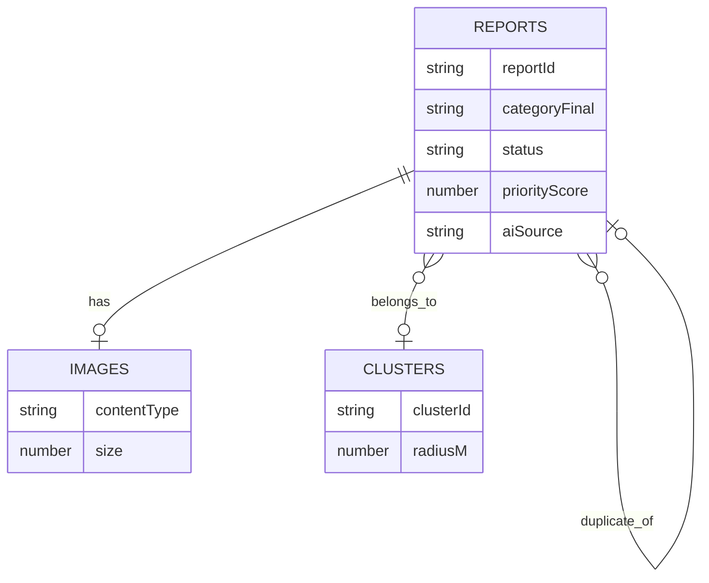
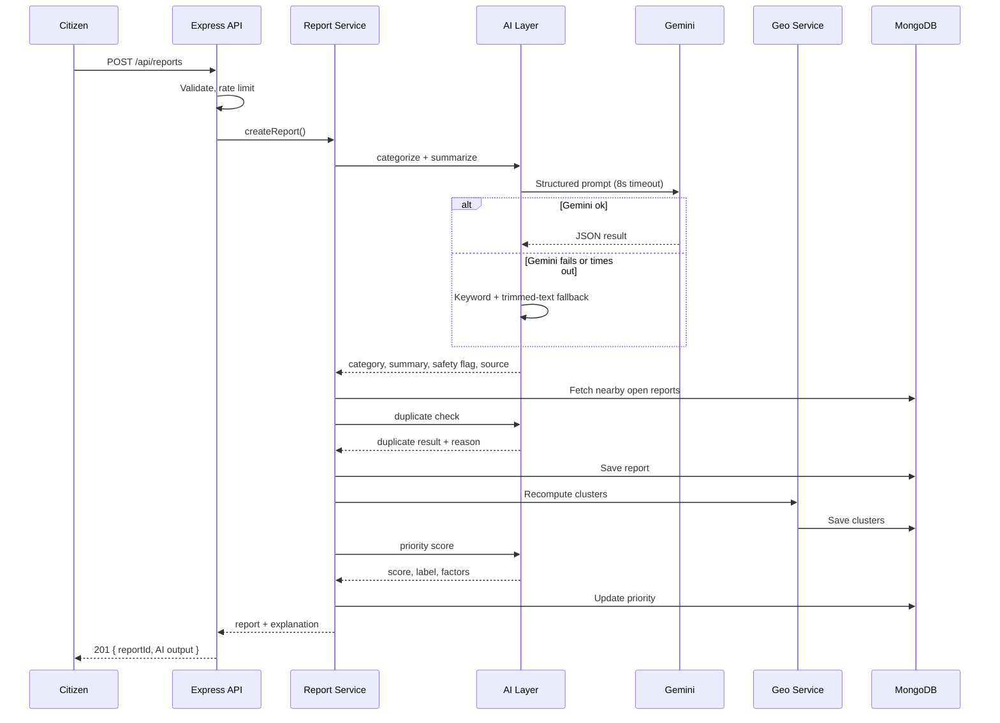
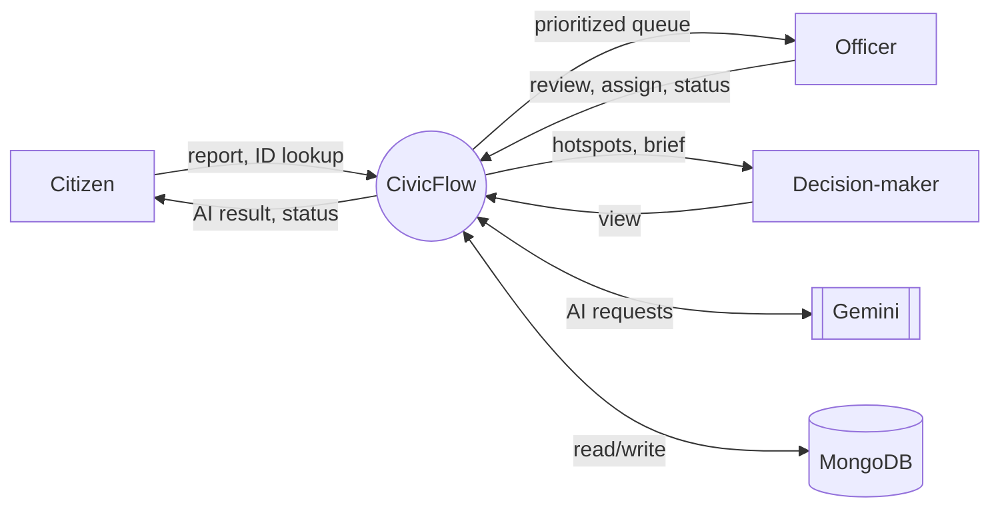
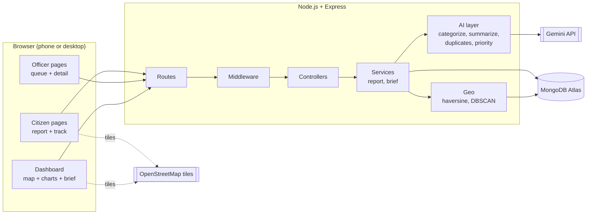
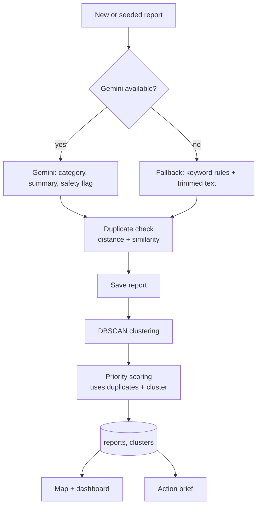
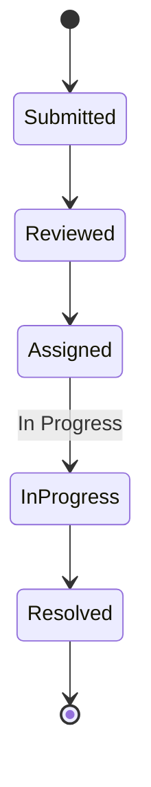

# CivicFlow – Architecture

> Hackathon: PromptWars x ASTRA – "From Complaints to Action"
> Status: Draft v2 (awaiting approval)
> Related: PRD.md, TRD.md, Documentation.md
> Diagrams use Mermaid (rendered on GitHub and in the VS Code Markdown preview).

---

## 1. Overview

This document is the technical blueprint of CivicFlow. It explains how the website is structured, how its parts communicate and how data moves through the system.

**Important:** this document describes how the system is **intended** to work. Nothing here claims that a part is already implemented. The final version will be updated to match the code (see Agent.md rule: keep documentation and implementation synchronized).

CivicFlow has five layers:

| Layer | Role |
|---|---|
| Frontend | What citizens, officers and decision-makers interact with |
| Backend | Handles requests, business rules and orchestrates the AI pipeline |
| Database | Stores reports, images, clusters and briefs |
| AI layer | Categorizes, summarizes, detects duplicates, scores priority, finds hotspots |
| External services | Gemini API, MongoDB Atlas, OpenStreetMap tiles, hosting |

---

## 2. Overall System Architecture

CivicFlow is a **single Node.js/Express application** that serves the REST API and the static frontend. One deployable unit keeps setup simple and fits the 8-hour window.

```
┌──────────────────────────────────────────────────────────┐
│ FRONTEND (static HTML + CSS + vanilla JS)                │
│ Citizen pages · Officer pages · Dashboard                │
└───────────────────────────┬──────────────────────────────┘
                            │ HTTPS / JSON
┌───────────────────────────▼──────────────────────────────┐
│ BACKEND – Node.js + Express                              │
│ Routes → Middleware → Controllers → Services             │
└───────┬──────────────────────┬───────────────────────────┘
        │                      │
┌───────▼─────────────┐  ┌─────▼────────────────────────────┐
│ AI LAYER (services) │  │ MongoDB Atlas                    │
│ Categorize          │  │ reports · images · clusters ·    │
│ Summarize           │  │ briefs                           │
│ Duplicates          │  └──────────────────────────────────┘
│ Priority · Hotspots │
└───────┬─────────────┘
        │
┌───────▼─────────────────────────────────────────────────┐
│ EXTERNAL: Gemini API · OpenStreetMap tiles · Render     │
└─────────────────────────────────────────────────────────┘
```

**Fallback rule:** if Gemini is unreachable or returns invalid output, the AI layer switches to keyword rules and TF-IDF automatically, and the report is marked `aiSource: "fallback"`.

---

## 3. Frontend Architecture

**Type:** multi-page static site served by Express from `public/`. No build step, no framework. Leaflet and Chart.js load from pinned CDN links.

> Note: this differs from a React-based frontend. A framework was deliberately avoided to reduce setup risk in an 8-hour solo build (see TRD.md Section 3). It can be revisited if you decide otherwise.

### Pages and routing
Routing is file-based: each page is its own HTML file.

| Page | Audience | Purpose |
|---|---|---|
| `index.html` | All | Landing page, links to report/track/officer |
| `report.html` | Citizen | Report form with map pin |
| `track.html` | Citizen | Enter report ID, see status timeline |
| `officer.html` | Officer | Passcode gate + prioritized queue |
| `report-detail.html` | Officer | AI output, explanation, assign, status, override |
| `dashboard.html` | Decision-maker | Map, hotspots, charts, action brief |

### Reusable components (plain JS functions in `ui.js`)
`renderNavbar()`, `renderReportCard()`, `renderPriorityBadge()`, `renderStatusBadge()`, `renderAiSourceTag()` (AI or fallback), `renderMockedTag()`, `showToast()`.

### State management
No global store. Each page keeps a small state object in its own module. The only persisted client state is the officer token in `sessionStorage` (cleared when the tab closes).

### API communication
All `fetch` calls live in `public/js/api.js`. Pages never call `fetch` directly. Errors are converted into user-friendly messages in one place.

### Responsive design
Mobile-first CSS with CSS variables and breakpoints for phone (default), tablet and desktop. The report form must work comfortably on a phone-sized screen (PRD FR-1.6).

### Safety rule
User-provided text is inserted with `textContent`, never raw `innerHTML`, to prevent XSS.

---

## 4. Backend Architecture

### Request pipeline

`Request → Route → Middleware → Controller → Service → Model/Database → Response`

| Layer | Responsibility |
|---|---|
| Routes | Map URLs and HTTP methods to controllers |
| Middleware | Validation, rate limiting, officer token check, upload handling, error handler |
| Controllers | Read the request, call services, shape the JSON response (no business logic) |
| Services | Business logic: AI pipeline, geo, scoring, brief |
| Models | Mongoose schemas and validation |
| Config | Environment loading and constants (categories, weights, thresholds) |

### Access control (prototype)
- Citizens need no account; they track by report ID.
- Officer and decision-maker routes require a **demo token**. The officer enters a shared passcode (`OFFICER_PASSCODE` from environment variables). The server returns a random token kept in server memory; the client sends it in an `Authorization` header.
- This is a **demo gate, not real authentication**, and the UI and README must say so. A server restart invalidates tokens, so the officer simply re-enters the passcode.
- Full user accounts (register/login, JWT, per-user data) are out of scope per PRD Section 10. They are listed as a "next step".

### Error handling
- Central error handler returns `{ ok: false, error: { code, message } }`.
- Gemini failures never produce a 500: they trigger the fallback.
- Unexpected errors are logged server-side without leaking stack traces to the client.

---

## 5. Database Architecture

MongoDB Atlas with Mongoose. Full field-level schemas will be in `Database.md`.

### Collections

| Collection | Purpose |
|---|---|
| `reports` | Every submitted report, including embedded AI analysis, status history and assignment |
| `images` | Uploaded image binaries (kept separate so list queries stay light) |
| `clusters` | Detected hotspots (recomputed after each new report and after seeding) |
| `briefs` | Cached action brief so the dashboard does not call Gemini on every load |

### How the suggested collections map to our design

| Typical collection | Our approach | Reason |
|---|---|---|
| Users | Not used (no accounts in the prototype) | Out of scope; demo passcode instead |
| Reports | `reports` collection | Core data |
| Categories | Constant list in `config/constants.js` | Fixed list of 8; no need for a collection |
| Assignments | Embedded `assignee` field in the report (mocked list) | Simple, one lookup |
| StatusHistory | Embedded `statusHistory[]` array in the report | Always read with the report |
| AIAnalysis | Embedded `ai` object in the report | Always read with the report |

### `reports` main fields

| Field | Notes |
|---|---|
| `reportId` | Short public ID (e.g., `CF-1042`), unique |
| `text` | Original description, max 1000 chars |
| `imageId` | Reference to `images` (optional) |
| `categoryUser`, `categoryAI`, `categoryFinal` | User choice, AI suggestion, value in use |
| `summary` | AI or fallback summary |
| `location` | `{ lat, lng, address? }` |
| `status` | Submitted, Reviewed, Assigned, In Progress, Resolved |
| `statusHistory[]` | `{ status, at, byRole, note? }` |
| `assignee` | Team or person name (mocked list, labelled) |
| `priority` | `{ score, label, factors[], overriddenBy? }` |
| `ai` | `{ source, safetyFlag, confidence?, reasonText }` |
| `duplicate` | `{ parentId?, similarity?, reason? }` |
| `clusterId` | Set after clustering |
| `isSeed` | `true` for synthetic data |
| `createdAt`, `updatedAt` | Timestamps |

### Relationships, indexes and validation
- `reports.imageId → images._id` (optional, one to one)
- `reports.clusterId → clusters.clusterId` (many to one)
- `reports.duplicate.parentId → reports.reportId` (many to one, self reference)
- Indexes: `reportId` (unique), `status`, `categoryFinal`, `createdAt`. Distance filtering is done in code because the dataset is small.
- Validation: Mongoose `required`, `enum` (category, status), `min/max` (lat/lng), `maxlength` (text), image size and MIME type checked before saving.



---

## 6. Module Structure

CivicFlow is divided into independent functional modules.

| # | Module | Responsibility | Main files |
|---|---|---|---|
| 1 | Officer Access (demo gate) | Passcode check, token issue and verification | `routes/auth.js`, `middleware/officerAuth.js` |
| 2 | Complaint Reporting | Receive, validate and store reports and images | `controllers/reportController.js`, `services/reportService.js` |
| 3 | AI Analysis | Categorize and summarize (Gemini + fallback) | `services/ai/categorize.js`, `summarize.js`, `geminiClient.js` |
| 4 | Duplicate Detection | Radius filter + text similarity, link duplicates | `services/ai/duplicates.js` |
| 5 | Priority Management | Weighted score and plain-language factors | `services/ai/priority.js` |
| 6 | Map and Hotspot | Haversine distance, DBSCAN, cluster storage | `services/geo/*`, `controllers/clusterController.js` |
| 7 | Officer/Admin Dashboard | Queue, detail, assign, status, override, charts, brief | `controllers/dashboardController.js`, `services/briefService.js`, `public/js/queue.js`, `detail.js`, `dashboard.js` |
| 8 | Complaint Tracking | Citizen status lookup with limited fields | `routes/reports.js` (track), `public/js/track.js` |
| 9 | Seed and Demo Data | Load synthetic reports through the same pipeline | `seed/seed.js` |

### Priority weights (total 100)

Starting values, to be tuned on the synthetic data.

| Factor | Max | How it is calculated |
|---|---|---|
| Safety risk | 35 | none 0, possible 15, clear hazard 35 |
| Category base severity | 25 | Fixed per category (e.g., Public Safety Hazard 25, Waterlogging 18, Road Damage 14, Streetlight 10, Garbage 8, Other 5) |
| Report count | 15 | +3 per linked duplicate, capped at 15 |
| Cluster membership | 10 | In a hotspot 10, otherwise 0 |
| Age (unresolved) | 15 | +1 per day open, capped at 15 |

**Labels:** Critical 75+, High 55–74, Medium 35–54, Low below 35.
The explanation shown to users is generated from the same factor list as the score, so the two can never disagree.

---

## 7. Component Interactions

1. The citizen opens `report.html`, fills the form and submits.
2. `report-form.js` sends the data to the backend through `api.js`.
3. The backend validates the input and calls the Report service.
4. The AI layer categorizes and summarizes (Gemini, or fallback).
5. The duplicate detector compares the report with nearby open reports.
6. The report is saved in MongoDB; clusters are recomputed.
7. The priority scorer calculates the score using duplicates and cluster data.
8. The citizen receives a report ID and sees the AI explanation.
9. The officer opens the queue, reviews the report, assigns it and moves the status.
10. The citizen enters the ID on `track.html` and sees the updated status and history.
11. The decision-maker opens the dashboard and sees hotspots and the action brief.



---

## 8. API Communication

Base path `/api`. JSON only (image upload uses `multipart/form-data`). These are **proposed** endpoints; `API.md` will be updated to match the implemented API.

| Method | Endpoint | Access | Request | Response |
|---|---|---|---|---|
| POST | `/api/reports` | Public | text, image?, category?, lat, lng, address? | `reportId`, category, summary, duplicate info, priority + factors |
| GET | `/api/reports/track/:reportId` | Public | – | ID, category, summary, status, history (no internal scores) |
| GET | `/api/reports` | Officer | filters: status, category, priority | Prioritized list |
| GET | `/api/reports/:reportId` | Officer | – | Full detail with AI explanation |
| PATCH | `/api/reports/:reportId/status` | Officer | `status`, `note?` | Updated report |
| PATCH | `/api/reports/:reportId/assign` | Officer | `assignee` | Updated report |
| PATCH | `/api/reports/:reportId/override` | Officer | `category?`, `priorityLabel?`, `reason` | Updated report (override recorded) |
| GET | `/api/images/:imageId` | Officer, or the tracking view | – | Image binary |
| GET | `/api/clusters` | Officer | – | Hotspots |
| GET | `/api/dashboard/summary` | Officer | – | Counts and chart data |
| GET | `/api/dashboard/brief` | Officer | `refresh?` | Action brief (cached) |
| POST | `/api/auth/officer` | Public | `passcode` | Demo token |
| GET | `/api/health` | Public | – | Server, DB and AI availability |

> Not included: `/api/auth/register`, `/api/auth/login` and a separate `/api/ai/analyze` endpoint. Accounts are out of scope, and AI analysis runs inside report creation instead of being a separate public endpoint.

**Response format:** `{ ok: true, data }` or `{ ok: false, error: { code, message } }`, with correct HTTP status codes.

---

## 9. Data Flow Diagrams

### 9.1 Level 0 (context)



### 9.2 Complaint-to-action flow

```
Citizen
   |
   v
Submit report (frontend)
   |
   v
Backend API (validate)
   |
   v
AI layer
   |
   +------> Category + summary
   |
   +------> Duplicate detection
   |
   +------> Priority calculation (after clustering)
   |
   v
MongoDB
   |
   v
Officer queue + Dashboard (map, hotspots, brief)
   |
   v
Assign and update status
   |
   v
Citizen tracking
```

---

## 10. System Architecture Diagrams

### 10.1 High-level system



### 10.2 AI processing workflow



### 10.3 Complaint lifecycle



Only forward moves, one step at a time. Reopening is out of scope.

---

## 11. Folder Structure

```
civicflow/
├── docs/                      # Project documentation
├── public/                    # Static frontend
│   ├── index.html
│   ├── report.html
│   ├── track.html
│   ├── officer.html
│   ├── report-detail.html
│   ├── dashboard.html
│   ├── css/
│   │   └── styles.css
│   └── js/
│       ├── api.js
│       ├── ui.js
│       ├── map.js
│       ├── report-form.js
│       ├── queue.js
│       ├── detail.js
│       ├── dashboard.js
│       └── track.js
├── server/
│   ├── app.js                 # Express setup
│   ├── index.js               # Starts the server
│   ├── config/
│   │   ├── env.js
│   │   └── constants.js       # Categories, weights, thresholds
│   ├── routes/
│   │   ├── reports.js
│   │   ├── dashboard.js
│   │   ├── clusters.js
│   │   ├── images.js
│   │   └── auth.js
│   ├── controllers/
│   │   ├── reportController.js
│   │   ├── dashboardController.js
│   │   ├── clusterController.js
│   │   ├── imageController.js
│   │   └── authController.js
│   ├── middleware/
│   │   ├── validate.js
│   │   ├── upload.js
│   │   ├── officerAuth.js
│   │   ├── rateLimit.js
│   │   └── errorHandler.js
│   ├── models/
│   │   ├── Report.js
│   │   ├── Image.js
│   │   ├── Cluster.js
│   │   └── Brief.js
│   └── services/
│       ├── reportService.js
│       ├── briefService.js
│       ├── ai/
│       │   ├── geminiClient.js
│       │   ├── categorize.js
│       │   ├── summarize.js
│       │   ├── duplicates.js
│       │   └── priority.js
│       └── geo/
│           ├── haversine.js
│           └── dbscan.js
├── seed/
│   ├── reports.json           # 30–50 synthetic reports
│   └── seed.js
├── tests/                     # Unit tests: scoring, DBSCAN, duplicates
├── .env.example
├── .gitignore
├── package.json
└── README.md
```

---

## 12. Integration Details

| Integration | Purpose | Configuration | Failure handling |
|---|---|---|---|
| Gemini API | Categorize, summarize, embeddings, action brief | `GEMINI_API_KEY`, `GEMINI_MODEL`; strict JSON prompts; 8 s timeout | Any error or invalid JSON → fallback; `aiSource = fallback` shown in the UI |
| MongoDB Atlas | Data storage | `MONGODB_URI` | Clear startup error; `/api/health` reports DB status |
| Leaflet + OpenStreetMap | Map and markers | Pinned CDN link, tile attribution | If tiles fail, markers and the list view still work |
| Nominatim (optional) | Address to coordinates | None (rate limited) | Disabled gracefully; pin and coordinates always work |
| Image storage | Uploaded images | Stored in MongoDB (`images`), max 2 MB | Report is saved without an image if the upload is invalid, with a clear message |
| Render | Hosting | Environment variables in the Render dashboard, `npm start` | Local run as backup; warm up the app before the demo |
| GitHub | Repository | `.env` in `.gitignore` | – |

**Not used in this version:** JWT/user accounts, Cloudinary (a separate image service), and a separate Vercel frontend. They would add keys, services and setup time. They can be listed as next steps in the README.

### Mocked components (labelled in the UI and README)
- Assignee list (fictional teams/people)
- Any status-change notification (if shown)
- Officer passcode gate (demo only)

---

## 13. Decisions Recorded Here

1. Single Express app serves API and frontend.
2. Backend layers: routes → middleware → controllers → services → models.
3. Embedded `statusHistory`, `assignee` and `ai` inside `reports`; categories as constants.
4. Images stored in MongoDB in a separate `images` collection (max 2 MB).
5. No user accounts; demo passcode and in-memory token for officer views.
6. Priority weights as in Section 6, tuned later on synthetic data.
7. Forward-only status workflow.

## 14. Open Points

- Field-level schemas and validation rules → `Database.md`
- Request/response examples → `API.md`
- Colors, typography, layouts → `Design.md`
- Duplicate radius and similarity thresholds → tuned in Phase 2
